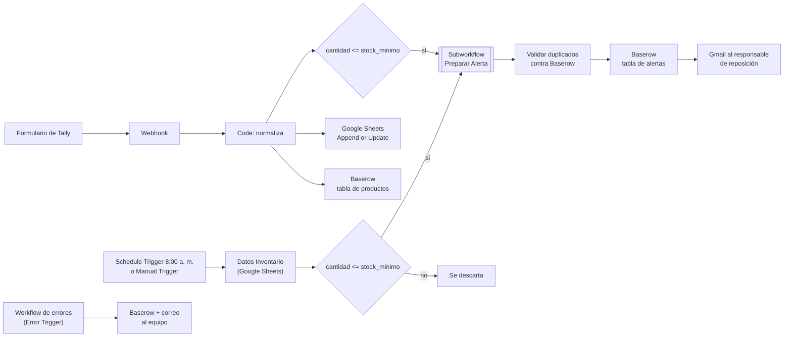

# Automatización de inventario — alertas de reposición con n8n

**Electiva IV · EAM-2026II**
**Integrantes:** William Rodriguez · Kevin Rengifo · Bryan Benavides · Michael Menotti

Sistema hecho en [n8n](https://n8n.io) para un almacén ficticio de tecnología y periféricos. Revisa el inventario cada día, da de alta productos nuevos desde un formulario de Tally, y cuando el stock llega al mínimo prepara una alerta por categoría, la registra en Baserow sin duplicarla y avisa por correo al responsable de reposición.

**Problema que resuelve.** Sin automatización, alguien debe revisar la hoja fila por fila, redactar el correo a mano y transcribir los productos nuevos desde el formulario. Así los productos críticos se detectan tarde, se cometen errores de digitación y no queda registro de qué se avisó. Beneficia al Gerente de Inventario, al Técnico de Almacén y al Encargado de Reposición.

> Todos los datos son ficticios. Los beneficios descritos son los esperados por diseño; el equipo no midió ahorros de tiempo.

---

## Alcance actual

**Funciones disponibles**

- Revisión programada (Schedule Trigger, 8:00 a. m. hora de Bogotá) o manual (Manual Trigger) de la hoja de Google Sheets; filtra `cantidad <= stock_minimo`.
- Alta de productos desde Tally mediante un Webhook; se guardan en Google Sheets y en Baserow.
- Subworkflow que valida, normaliza, clasifica (Periféricos / Monitores / Otras categorías) y redacta la alerta; los datos inválidos se devuelven como `invalida` con su motivo.
- Control de duplicados contra la tabla de alertas de Baserow.
- Registro de la alerta en Baserow y correo por Gmail.
- Workflow de errores: registra el fallo en Baserow y avisa por correo.

**Limitaciones principales**

- No descuenta stock, no genera órdenes de compra ni cierra alertas al reponer; no notifica por Slack.
- Reenviar un evento de Tally puede duplicar la fila del producto en Baserow.
- La normalización no elimina tildes (`Periféricos` cae en "Otras categorias").
- El Webhook no valida firma y depende de un túnel temporal (ngrok).
- El primer disparo automático del Schedule a las 8:00 a. m. aún no está registrado en el historial de ejecuciones.

La lista completa está en la sección 7.8 de la [bitácora unificada](Bitacora_Unificada_Proyecto.md#78-limitaciones-conocidas).

---

## Arquitectura

Diagrama del proceso actual frente al automatizado: [Evidencias/Diagrama.Inventario.drawio.png](diagramas/diagrama_automatizacion.png).

| Workflow | Archivo | Responsabilidad |
| --- | --- | --- |
| **Principal** | [`workflows/Inventario_productos_Tally_Webhook_baserow_con_subworkflow.json`](workflows/Inventario_productos_Tally_Webhook_baserow_con_subworkflows.json) | Recibe las dos entradas (revisión programada y alta por Tally), lee y escribe en Sheets y Baserow, llama al subworkflow, controla duplicados, registra la alerta y envía el correo |
| **Subworkflow** `Preparar Alerta Reposicion` | [Ver el archivo Subworkflow](<Subworkflow - Preparar Alerta de Reposicion.json>) | Valida, normaliza, clasifica por categoría y redacta la alerta (`preparada` o `invalida`). No usa servicios externos |
| **Errores** | [Workflow de Errores - Inventario](<workflows/Workflow de Errores - Inventario.json>) | `Error Trigger`: cuando falla el principal, registra el fallo en Baserow y avisa por correo |

Un **subworkflow** es un workflow que otro workflow llama como si fuera un solo paso; aquí concentra las reglas de la alerta para que el principal quede ordenado.

---

## Requisitos

| Requisito | Detalle |
| --- | --- |
| n8n | Instalación local (self-hosted). La versión exacta se ve en *Settings → About n8n*; debe incluir el trigger *When Executed by Another Workflow* con campos de entrada tipados |
| Google | Cuenta con Google Sheets y Gmail; credencial OAuth2 con permiso de **edición** sobre la hoja y de envío de correo |
| Baserow | Cuenta en [baserow.io](https://baserow.io) (nube), una base con tres tablas (productos, alertas, errores) y un token de API con permiso de leer y crear filas |
| Tally | Cuenta en [tally.so](https://tally.so) con permiso para configurar Webhooks del formulario |
| Túnel | [ngrok](https://ngrok.com) (u otro) para que Tally llegue al n8n local |
| Zona horaria | América/Bogotá en el Schedule Trigger |

---

## Configuración

Use **cuentas propias**; las credenciales del equipo no están en el repositorio.

1. **Google Sheets.** Cree una hoja con las columnas `producto`, `categoria`, `cantidad`, `stock_minimo` (y `id`, que se usa como columna de coincidencia en *Append or Update*). Comparta la hoja con permiso de edición con la cuenta que autorizará n8n.
2. **Baserow.** Cree una base con tres tablas:
   - **Productos:** una columna por cada dato que envía el HTTP Request (producto, categoría, cantidad, stock mínimo); los nombres deben coincidir con el cuerpo JSON del nodo.
   - **Alertas:** al menos `Nombre` y `Nota`.
   - **Errores:** una columna para la fecha y hora del fallo.

   Cree un token de API (*Settings → Database tokens*) con permiso de leer y crear filas.
3. **Tally.** Cree un formulario con las preguntas `Nombre del producto`, categoría (opciones: Perifericos, Monitores, Componentes u otras), `Cantidad Inicial` y `Stock Minimo establecido`. Las etiquetas deben coincidir con estas, porque el nodo Code busca los campos por etiqueta.
4. **Credenciales en n8n** (*Credentials*): Google Sheets OAuth2, Gmail OAuth2 y una credencial con la cabecera `Authorization: Token <SU_TOKEN_BASEROW>` para los nodos HTTP Request. No guarde tokens dentro de los JSON ni los suba a GitHub.
5. **Túnel.** Inicie ngrok hacia el puerto de n8n (`ngrok http 5678`) y arranque n8n con la variable `WEBHOOK_URL` igual a la URL pública de ngrok, para que n8n muestre la URL correcta del Webhook.

---

## Importación y conexiones

1. Importe **primero** el subworkflow `Subworkflow_Preparar_Alerta_Reposicion.json` (*Workflows → Import from file*).
2. Importe `Workflow_Errores_Inventario.json` y reconecte sus credenciales (Baserow y Gmail) y el ID de su tabla de errores.
3. Importe el principal `Inventario_productos_Tally_Webhook_baserow_con_subworkflow.json`. El nodo `Subworkflow Preparar Alerta` queda **sin workflow seleccionado**, porque los identificadores no se comparten entre instalaciones.
4. En ese nodo elija *Workflow → From list* el subworkflow importado y revise el mapeo de los 5 campos: `producto`, `categoria`, `cantidad`, `stock_minimo`, `fila_hoja`. Debe ejecutarse **una sola vez con todos los items** y esperar su finalización.
5. En el principal abra *Settings → Error workflow* y seleccione `Workflow_Errores_Inventario`.
6. Reconecte las credenciales en cada nodo de Google Sheets, Gmail y HTTP Request.
7. Cambie los IDs de tabla de Baserow (en el proyecto `1227755` productos y `1227756` alertas) por los de su cuenta en los nodos HTTP Request.
8. Elija su hoja de Google Sheets en `Datos Inventario` y en el nodo *Append or Update*.
9. Confirme la zona horaria América/Bogotá en el `Schedule Trigger`.

No use los JSON antiguos de la carpeta `historial_bitacoras/` para configurar una copia.

---

## Ejecución

### Modo prueba (sin activar el workflow)

- **Revisión de inventario:** abra el principal y pulse *Execute workflow* desde el `Manual Trigger`.
- **Alta desde Tally:** haga clic en *Listen for test event* en el nodo Webhook y envíe el formulario a la **URL de prueba** (`/webhook-test/<ruta>`). Esa URL solo responde mientras el nodo está escuchando.
- **Subworkflow aislado:** ejecutado solo, llega sin datos (`null`). Fije datos de prueba (*pin data*) en `Recibir datos de alerta` o llámelo desde el principal.
- Una ejecución manual **no** dispara el workflow de errores.

### Funcionamiento habitual (producción)

1. Active (publique) el principal con el interruptor *Active*; sin esto no corre el Schedule ni responde la URL de producción.
2. **Entrada A:** a las 8:00 a. m. (Bogotá) el `Schedule Trigger` revisa la hoja.
3. **Entrada B:** en Tally configure el Webhook del formulario con la **URL de producción** (`https://<URL_NGROK>/webhook/<ruta>`) y mantenga el túnel encendido.
4. **Dónde ver el resultado:**
   - Productos nuevos: la hoja de Google Sheets y la tabla de productos de Baserow.
   - Alertas: la tabla de alertas de Baserow y el correo del responsable de reposición.
   - Fallos: tabla de errores de Baserow, correo de aviso y la pestaña *Executions* de n8n.

### Detener al terminar las pruebas

- Desactive el principal (interruptor *Active*) para que el Schedule deje de ejecutarse y la URL de producción deje de responder.
- Cierre ngrok (`Ctrl + C`) y elimine o desactive el Webhook en Tally.

---

## Prueba de ejemplo

Datos ficticios, caso de la prueba PR-03/PR-06 de la bitácora.

**Entrada.** Envíe el formulario de Tally con:

| Pregunta | Valor |
| --- | --- |
| Nombre del producto | Mouse Logitech |
| Categoría | Perifericos |
| Cantidad Inicial | 2 |
| Stock Minimo establecido | 5 |

**Pasos.** (1) Inicie el túnel y deje el Webhook escuchando (URL de prueba) o el workflow activo (URL de producción). (2) Envíe el formulario. (3) Revise las filas creadas y el correo.

**Salida esperada**

1. El nodo Code entrega el JSON normalizado (producto, categoría `perifericos`, cantidad 2, stock mínimo 5).
2. Una fila nueva (o actualizada, si ya existía `Mouse Logitech`) en Google Sheets.
3. Una fila nueva en la tabla de productos de Baserow, con los campos llenos.
4. Como 2 ≤ 5, el subworkflow devuelve `estado = preparada` con el mensaje: *"El periferico Mouse Logitech tiene el stock menor al minimo. Cantidad: 2"* y un `ticket` con la forma `perifericos-mouse logitech-<marca de tiempo>`.
5. Una fila en la tabla de alertas de Baserow y un correo de alerta al responsable de reposición.
6. Si reenvía el mismo formulario, la alerta se detecta como repetida y no se registra otra, pero la fila del producto sí puede duplicarse (limitación conocida).

**Prueba de revisión programada (Manual Trigger).** Con una hoja de 8 productos ficticios como esta:

| producto | categoria | cantidad | stock_minimo |
| --- | --- | --- | --- |
| Mouse Logitech | Perifericos | 2 | 5 |
| Teclado Genius | Perifericos | 1 | 4 |
| Monitor Samsung 24 | Monitores | 0 | 3 |
| Disco SSD 1TB | Componentes | 3 | 6 |
| Memoria RAM 16GB | Componentes | 1 | 5 |
| Cable HDMI | Perifericos | 20 | 5 |
| Monitor LG 27 | Monitores | 9 | 3 |
| Webcam HD | Perifericos | 12 | 4 |

se espera que pasen el filtro 5 productos (3 de `cantidad <= stock_minimo` en periféricos y monitores más 2 de otras categorías): 2 periféricos, 1 monitor y 2 por la ruta por defecto, cada uno con `ticket`, `asunto` y `cuerpo`.

**Prueba de fallo (opcional).** En una **copia** del principal, reemplace el token de Baserow por uno inválido, active la copia y envíe el formulario: la ejecución falla en el nodo de Baserow y el workflow de errores registra el fallo y envía el correo de aviso.

---

## Documentación y evidencias

| Documento | Contenido |
| --- | --- |
| [Bitácora unificada](Bitacora_Unificada_Proyecto.md) | Documentación completa: alcance, reglas, integraciones, errores, pruebas y estado final |
| [Presentación en PDF](documentacion/presentacion_proyecto_2do_corte.pdf) | Resumen del proyecto para quien no conoce n8n |
| [Diagrama proceso actual vs automatizado](documentacion/diagramas/diagrama_automatizacion.png) | Comparación visual del proceso |
| [Índice de evidencias y pruebas](Bitacora_Unificada_Proyecto.md#63-índice-de-evidencias-disponibles) | Capturas en [`evidencias/`](evidencias/) y la prueba a la que corresponde cada una |

video de demostracion: 

https://github.com/user-attachments/assets/2dc45469-9607-459b-aa2b-45d83cb3b304

