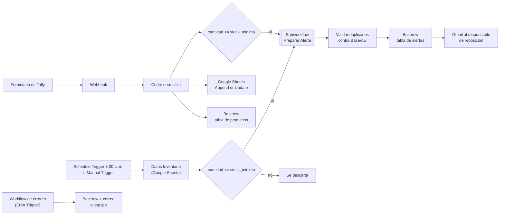

# Bitácora unificada — Automatización de inventario (alertas de reposición)

> Describe el **estado actual** de la solución, no la historia clase por clase. Las bitácoras C02–C08 se conservan como historial en `historial_bitacoras/`. Cuando dos bitácoras se contradicen, aquí aparece la versión vigente y la contradicción queda anotada en el **Anexo A**.

---

## 1. Identificación y alcance

### 1.1 Proyecto y equipo

| Campo                                     | Registro                                                                                                                                                                  |
| ----------------------------------------- | ------------------------------------------------------------------------------------------------------------------------------------------------------------------------- |
| Proyecto                                  | Automatización de inventario: alertas de stock bajo y alta de productos desde formulario                                                                                  |
| Curso                                     | Electiva IV · EAM-2026II                                                                                                                                                  |
| Área u organización ficticia              | Almacén de Tecnología y Periféricos                                                                                                                                       |
| Integrantes                               | William Rodriguez, Kevin Rengifo, Bryan Benavides, Michael Menotti                                                                                                        |
| Fecha de actualización                    | 2026-10-26                                                                                                                                                                |
| Estado de la bitácora fuente más reciente | C08 (clase del 2026-10-26): subworkflow, control de duplicados y workflow de errores                                                                                      |
| Workflows entregados                      | `Subworkflow_Preparar_Alerta_Reposicion.json`, `Inventario_productos_Tally_Webhook_baserow_con_subworkflow.json` (principal) y `Workflow_Errores_Inventario.json` (errores) |

### 1.2 Responsabilidades de cada integrante

| Integrante            | Responsabilidad en la versión entregada                                                                         | Aportes registrados en las bitácoras                                                                                                                                                                                 | Aporte verificable                                                                                                                                                                                       |
| --------------------- | --------------------------------------------------------------------------------------------------------------- | -------------------------------------------------------------------------------------------------------------------------------------------------------------------------------------------------------------------- | -------------------------------------------------------------------------------------------------------------------------------------------------------------------------------------------------------- |
| **William Rodriguez** | Creación del subworkflow de alerta de restock; seguimiento del proyecto                                         | Registro de decisiones y aprendizajes (C02–C03); reconfiguración del Switch para leer `categoria_limpia` (C04); tarjetas de seguimiento (C06–C07); subworkflow (C08)                                                 | [switch_categorias.png](Evidencias/switch_categorias.png) (Switch reconfigurado, PR-01); [subworkflow_alertas_otras_categoria.png](Evidencias/subworkflow_alertas_otras_categoria.png) (subworkflow, PR-02) |
| **Kevin Rengifo**     | Validación del JSON y de la normalización; organización de tarjetas                                             | Validaciones (C02); diseño de las 3 alertas (C03); nodo `Datos Inventario` y corrección del `ticket` con `undefined` (C04); tarjetas (C06–C07); validación de la normalización (C08)                                 | [Alerta_perifericos.png](Evidencias/Alerta_perifericos.png), [Alerta_Monitores.png](Evidencias/Alerta_Monitores.png), [Alerta_otras_categorias.png](Evidencias/Alerta_otras_categorias.png) (las 3 alertas); [normalizar_datos.png](Evidencias/normalizar_datos.png) (PR-01) |
| **Bryan Benavides**   | Construcción técnica de los workflows (flujo, Switch, normalización, Baserow, Webhook, subworkflow, duplicados) | Estructura del flujo (C02); Switch (C03); nodo `Normalizar Datos` (C04); base en Baserow y HTTP Request (C06); Webhook de Tally, nodo Code y HTTP Request (C07); subworkflow, mapeo y corrección de duplicados (C08) | Los tres archivos JSON entregados: `Subworkflow_Preparar_Alerta_Reposicion.json`, `Inventario_productos_Tally_Webhook_baserow_con_subworkflow.json` y `Workflow_Errores_Inventario.json`                  |
| **Michael Menotti**   | Registro de decisiones técnicas, errores y aprendizajes; diagramas                                              | Pruebas y validación como rol inicial (C02); diagrama proceso actual vs automatizado (C04); registro técnico (C06–C08)                                                                                               | [Diagrama.Inventario.drawio.png](Evidencias/Diagrama.Inventario.drawio.png) (proceso actual vs automatizado)                                                                                                                                                                         |

### 1.3 Problema y quién lo enfrenta

En el almacén los productos no se monitoreaban en tiempo real. Cuando el stock llegaba a niveles críticos no había una alerta automática y se producía desabastecimiento sin aviso previo. Además, dar de alta un producto nuevo exigía revisar las respuestas del formulario una por una y pasarlas a la hoja de inventario a mano.

Quienes lo enfrentan son tres roles: el **Gerente de Inventario**, el **Técnico de Almacén** y el **Encargado de Reposición**.

### 1.4 Objetivo de la automatización

1. Revisar el inventario de forma rutinaria (cada día a las 8:00 a. m., hora de Bogotá) y detectar los productos cuyo stock llegó al mínimo.
2. Dar de alta productos nuevos en tiempo real desde un formulario de Tally, guardándolos en Google Sheets y en Baserow.
3. Preparar para cada producto con stock bajo una alerta clasificada por categoría, con asunto y cuerpo listos para enviar.
4. Registrar cada alerta en Baserow sin duplicarla y avisar por correo al responsable de reposición.
5. Registrar los fallos técnicos del flujo y avisar al equipo.

### 1.5 Qué incluye la versión entregada

| Componente                           | Descripción                                                                                                                                              | Estado                                                                                                                                                  |
| ------------------------------------ | -------------------------------------------------------------------------------------------------------------------------------------------------------- | ------------------------------------------------------------------------------------------------------------------------------------------------------- |
| Entrada A: revisión programada       | Schedule Trigger diario a las 8:00 a. m. (Bogotá) y Manual Trigger paralelo para pruebas; lee la hoja de Google Sheets y filtra stock bajo               | Lógica comprobada con ejecución manual (PR-01, versión C04). Schedule Trigger configurado (PR-05); su primer disparo automático a las 8:00 a. m. no está registrado aún |
| Entrada B: alta por formulario       | Webhook que recibe `FORM_RESPONSE` de Tally; nodo Code que normaliza; escritura en Google Sheets (*Append or Update*) y en Baserow (HTTP Request `POST`) | Comprobado en C07 (PR-03) y en la ejecución completa PR-06                                                                                              |
| Subworkflow de preparación de alerta | Valida, normaliza, clasifica por categoría y redacta la alerta; devuelve `estado` = `preparada` o `invalida`                                             | Implementado en C08; recorrido dentro de la ejecución completa PR-06                                                                                    |
| Control de duplicados                | Consulta las alertas existentes en Baserow y compara `Nombre` + `Nota`                                                                                   | Reescrito en C08; probado con datos de ejemplo fuera de n8n; no tiene una prueba propia registrada en n8n                                               |
| Registro de alertas y aviso          | Registro de la alerta en Baserow (tabla `1227756`) y correo por Gmail al responsable de reposición                                                       | Comprobado en PR-06 (fila en Baserow y correo recibido)                                                                                                 |
| Workflow de errores                  | `Error Trigger` asociado al principal; registra la fecha y hora del fallo en Baserow y avisa por correo                                                  | Implementado en C08 y comprobado en PR-04                                                                                                               |

### 1.6 Archivos del proyecto

| Archivo | Papel actual |
| --- | --- |
| `Inventario_productos_Tally_Webhook_baserow_con_subworkflow.json` | **Workflow principal vigente.** Contiene las dos entradas (A y B) y el registro y aviso |
| `Subworkflow_Preparar_Alerta_Reposicion.json` | **Subworkflow vigente.** Debe importarse primero |
| `Workflow_Errores_Inventario.json` | **Workflow de errores vigente.** Se asocia al principal en *Settings → Error workflow* |
| `Automatizacion-Inventario.json` (C02), `Automatizacion-Inventario 1.json` (C03), `Automatizacion-Inventario_solo_baserow.Json` (C06), `Inventario_productos_Tally_Webhook.Json` (C07) | Historial. No usar para configurar una copia |

### 1.7 Qué queda por fuera del alcance

- No descuenta stock por ventas, salidas o entradas: la cantidad proviene de la hoja o del formulario.
- No genera órdenes de compra ni contacta proveedores.
- No cierra ni resuelve alertas cuando el producto se repone.
- No notifica por Slack ni por otros canales.
- No edita ni elimina productos desde el formulario; el formulario solo da de alta o actualiza.
- No tiene interfaz propia: el alta se hace por Tally y la consulta por Google Sheets o Baserow.
- Trabaja solo con datos ficticios; no hay datos reales de una organización.

---

## 2. Proceso manual y proceso automatizado

### 2.1 Cómo se hace sin automatización

1. El responsable abre la hoja de inventario y revisa producto por producto si la cantidad llegó al stock mínimo.
2. Anota los productos críticos y los agrupa por tipo (periféricos, monitores, otros).
3. Redacta el correo a mano y lo envía al encargado de reposición.
4. Para los productos nuevos, alguien consulta las respuestas del formulario de Tally una por una y las transcribe a la hoja.
5. No queda un registro estructurado de qué alertas se enviaron ni cuándo.

### 2.2 Dificultades del proceso manual

| Dónde aparece el problema                                       | Consecuencia                                                       |
| --------------------------------------------------------------- | ------------------------------------------------------------------ |
| La revisión depende de que alguien se acuerde de hacerla        | Productos con stock crítico no se detectan a tiempo                |
| Revisar cada fila a mano                                        | Tarea repetitiva y lenta; riesgo de omitir productos               |
| Transcribir respuestas de Tally                                 | Retraso en la actualización del inventario y errores de digitación |
| Categorías escritas con mayúsculas, espacios o tildes distintas | La clasificación falla o se mezcla                                 |
| Enviar el correo manualmente                                    | La información llega tarde o se pierde                             |
| No hay tabla de alertas                                         | No se puede consultar ni saber si una alerta ya se avisó           |

### 2.3 Qué cambia con la automatización

| Aspecto             | Sin automatización                                                 | Con n8n                                                                                      |
| ------------------- | ------------------------------------------------------------------ | -------------------------------------------------------------------------------------------- |
| Revisión del stock  | Cuando alguien se acuerda, fila por fila                           | Diaria a las 8:00 a. m., todos los productos a la vez                                        |
| Alta de productos   | Se copian las respuestas de Tally a mano                           | El Webhook las recibe al instante y las guarda en Sheets y Baserow                           |
| Datos sucios        | Mayúsculas, espacios y etiquetas distintas rompen la clasificación | Mayúsculas y espacios se normalizan antes de decidir (las tildes no; ver limitación 5 de 7.8) |
| Clasificación       | Mental o manual                                                    | Switch por categoría con ruta por defecto: ningún producto se pierde                         |
| Redacción del aviso | A mano                                                             | Asunto y cuerpo generados según la categoría                                                 |
| Registro            | No existe                                                          | Tabla de alertas en Baserow con control de duplicados                                        |
| Datos incompletos   | Pasan inadvertidos                                                 | Se devuelven como `invalida` con su motivo                                                   |
| Notificación        | Correo manual                                                      | Correo por Gmail desde el flujo                                                              |
| Fallos técnicos     | Nadie los registra                                                 | El workflow de errores los registra en Baserow y avisa por correo                            |

> Los beneficios de esta tabla son los esperados por diseño. El equipo no midió ahorros de tiempo ni porcentajes de mejora.

---

## 3. Funcionamiento de la solución

### 3.1 Flujo general

La solución tiene dos entradas que terminan en la misma preparación de alertas.



**Entrada A: revisión programada**

1. A las 8:00 a. m. se activa el `Schedule Trigger`. Para probar sin esperar se usa el `Manual Trigger`, que está conectado en paralelo.
2. `Datos Inventario` lee la hoja de Google Sheets con todos los productos.
3. Un filtro conserva los productos con `cantidad <= stock_minimo`. Los demás se descartan.
4. El principal llama **una sola vez** al subworkflow con todos los productos que pasaron el filtro y espera su resultado.
5. El subworkflow devuelve un resultado por producto: `preparada` (con ticket, asunto y cuerpo) o `invalida` (con motivo).
6. Las alertas `preparadas` se comparan con las que ya existen en Baserow; las nuevas se registran y se notifican por correo.

**Entrada B: alta de producto por formulario**

1. Alguien llena el formulario de Tally. Tally envía un `POST` con el evento `FORM_RESPONSE` a la URL del Webhook.
2. El nodo Code extrae del payload el producto, la categoría, la cantidad inicial y el stock mínimo, y los normaliza. Si no reconoce el payload, lanza el error "Payload no reconocido".
3. El producto se guarda **en paralelo** en Google Sheets (*Append or Update*) y en Baserow (HTTP Request `POST`).
4. Si la cantidad es igual o menor al mínimo, el producto sigue al mismo subworkflow y al mismo registro y aviso de la entrada A.

### 3.2 Campos que se utilizan

**Datos que llegan desde Tally** (etiquetas del formulario según C07):

| Etiqueta                   | Uso                           | Obligatorio para generar la alerta |
| -------------------------- | ----------------------------- | :--------------------------------: |
| `Nombre del producto`      | Nombre del producto           |                 Sí                 |
| `Categoría`                | Define la ruta del Switch     |                 Sí                 |
| `Cantidad Inicial`         | Se guarda como `cantidad`     |                 Sí                 |
| `Stock Minimo establecido` | Se guarda como `stock_minimo` |                 Sí                 |

**Columnas de la hoja de Google Sheets** (C02): `producto`, `categoria`, `cantidad`, `stock_minimo`. La coincidencia de *Append or Update* usa una columna llamada `id` a la que se le asigna `{{ $json.producto }}` (C07).

**Contrato de entrada del subworkflow** (trigger `Recibir datos de alerta`, con tipos declarados):

| Campo | Tipo | Ejemplo | Obligatorio |
| --- | --- | --- | :-: |
| `producto` | texto | `Mouse Logitech` | Sí |
| `categoria` | texto | `Perifericos` | Sí |
| `cantidad` | número | `2` | Sí (≥ 0) |
| `stock_minimo` | número | `5` | Sí (≥ 0) |
| `fila_hoja` | texto | `4` | Para ubicar el producto en la hoja |

### 3.3 Cómo se limpia, transforma y valida la información

| Paso | Dónde | Qué hace |
| --- | --- | --- |
| Extraer del payload de Tally | Nodo Code (principal) | Busca cada campo por etiqueta con `includes` (búsqueda flexible), extrae texto y números y formatea la categoría a partir de las opciones que Tally entrega dentro de arreglos |
| Limpiar texto | `Normalizar Datos` / subworkflow | `trim()` quita espacios y `toLowerCase()` unifica mayúsculas en la categoría; el nombre se limpia sin perder legibilidad |
| Normalizar antes de decidir | Subworkflow | El Switch solo lee el campo limpio, nunca el dato crudo (decisión de C04) |
| Validar | Subworkflow | Un dato vacío, no numérico o negativo se devuelve como `invalida` con su motivo; **no** se usa *Stop And Error* |
| Validar tipos | Trigger del subworkflow | Los campos declarados como texto o número hacen visible un tipo incorrecto, pero no sustituyen las reglas del negocio: un texto puede tener el tipo correcto y estar vacío |

### 3.4 Reglas y rutas

| # | Regla | Si se cumple | Si no se cumple |
| --- | --- | --- | --- |
| R1 | `cantidad <= stock_minimo` | El producto pasa a preparar alerta | Se descarta; no hay alerta |
| R2 | Algún campo vacío, no numérico o negativo | Resultado `invalida` + `motivo` | Continúa a la clasificación |
| R3 | Categoría normalizada = `perifericos` | Mensaje: "El periferico [PRODUCTO] tiene el stock menor al minimo. Cantidad: [N]" | Se evalúa la siguiente |
| R4 | Categoría normalizada = `monitores` | Mensaje: "El monitor [PRODUCTO] tiene el stock menor al minimo. Cantidad: [N]" | Se evalúa la siguiente |
| R5 | Cualquier otra categoría (ruta por defecto "Otras categorias") | Mensaje: "El producto [PRODUCTO] tiene el stock menor al minimo. Cantidad: [N]" | No aplica: nada queda sin procesar |
| R6 | La alerta (`Nombre` + `Nota`) ya existe en Baserow o está repetida en el lote | Se descarta | Se registra y se notifica |
| R7 | Payload de Tally no reconocido | Se lanza el error "Payload no reconocido" y la ejecución se detiene en ese nodo | Continúa la normalización |

### 3.5 Responsabilidad de cada workflow

| Workflow                                     | Responsabilidad                                                                                                                                    | Recibe                                                                              | Devuelve                                                     | Servicios externos            |
| -------------------------------------------- | -------------------------------------------------------------------------------------------------------------------------------------------------- | ----------------------------------------------------------------------------------- | ------------------------------------------------------------ | ----------------------------- |
| **Principal**                                | Recibir las dos entradas, leer y escribir en Sheets y Baserow, llamar al subworkflow, controlar duplicados, registrar la alerta y enviar el correo | Disparo del Schedule/Manual, o evento de Tally                                      | Filas en Sheets y Baserow, alertas registradas, correos      | Google Sheets, Baserow, Gmail |
| **Subworkflow** `Preparar Alerta Reposicion` | Validar, normalizar, clasificar por categoría y redactar la alerta                                                                                 | Lista de items con `producto`, `categoria`, `cantidad`, `stock_minimo`, `fila_hoja` | Un item por producto con `estado` (`preparada` o `invalida`) | Ninguno                       |
| **Workflow de errores** `Workflow_Errores_Inventario` | Captar los fallos técnicos del principal, registrarlos y avisar al equipo                                                                 | El fallo reportado por n8n mediante `Error Trigger`                                 | Fila de error en Baserow y correo al equipo                  | Baserow, Gmail                |

El subworkflow no tiene datos propios: su trigger recibe lo que le entrega el principal. Ejecutado solo, llega vacío y los datos salen en `null`; por eso se prueba con datos fijados (*pin data*) en `Recibir datos de alerta` o llamándolo desde el principal.

### 3.6 Dónde se consulta, crea o actualiza la información

| Recurso                              | Consulta | Crea | Actualiza | Nodo / momento                                                                      |
| ------------------------------------ | -------- | :--: | :-------: | ----------------------------------------------------------------------------------- |
| Google Sheets (hoja de inventario)   | ✓        |  ✓   |     ✓     | Lectura en `Datos Inventario`; *Append or Update* desde el Webhook                  |
| Baserow, tabla `1227755` (productos) | —        |  ✓   |     —     | HTTP Request `POST` desde el Webhook                                                |
| Baserow, tabla `1227756` (alertas)   | ✓        |  ✓   |     —     | `Consultar alertas existentes` antes de `Validar duplicados`; registro de la alerta |
| Baserow, tabla de errores            | —        |  ✓   |     —     | Workflow de errores, cuando falla un nodo del principal                             |
| Gmail                                | —        |  ✓   |     —     | Después de registrar la alerta; y desde el workflow de errores                      |
| Historial de ejecuciones de n8n      | ✓        |  ✓   |     —     | Registro de cada ejecución, correcta o fallida                                      |

### 3.7 Expresiones importantes

> Los ejemplos de entrada y salida usan datos ficticios.

**1. `categoria_limpia`** — evita que mayúsculas o espacios rompan la clasificación.

```js
{{ ($json.categoria || '').trim().toLowerCase() }}
```

| Entrada (`categoria`) | Salida (`categoria_limpia`) |
| --- | --- |
| `"  Perifericos "` | `"perifericos"` |
| `"MONITORES"` | `"monitores"` |
| *(vacío o inexistente)* | `""` (el subworkflow lo devuelve como `invalida`) |

> En C04 la expresión aparece escrita con `|` simple por el escape de la tabla Markdown. La forma funcional es `||`. Un `|` simple devolvería `0` y no limpiaría nada.

**2. `producto_limpio`** — limpia el nombre sin cambiar su legibilidad.

```js
{{ ($json.producto || '').trim() }}
```

| Entrada | Salida |
| --- | --- |
| `"  Mouse Logitech "` | `"Mouse Logitech"` |

**3. `producto_normalizado`** — clave uniforme en minúsculas para búsquedas.

```js
{{ $json.producto_limpio.toLowerCase() }}
```

| Entrada (`producto_limpio`) | Salida (`producto_normalizado`) |
| --- | --- |
| `"Mouse Logitech"` | `"mouse logitech"` |

Se lee `producto_limpio` (creado por el nodo anterior) y no `producto_normalizado`: un nodo Set no puede leer un campo que él mismo crea en la misma pasada. Hacerlo producía tickets con `undefined`.

**4. `ticket`** — identificador único por alerta.

```js
{{ $json.categoria_limpia + '-' + $json.producto_limpio.toLowerCase() + '-' + Date.now() }}
```

| Entrada | Salida |
| --- | --- |
| `categoria_limpia = "perifericos"`, `producto_limpio = "Mouse Logitech"` | `"perifericos-mouse logitech-1730000000000"` |

El número final es la marca de tiempo en milisegundos. Hace único cada ticket, pero por eso mismo **no sirve para detectar duplicados**: dos ejecuciones del mismo producto generan tickets distintos.

**5. Condiciones del Switch en minúscula.** El Switch compara contra `perifericos` y `monitores` porque recibe el campo limpio. Se bajaron los valores de comparación, no los *Output Name*. Con `categoria_limpia = "componentes"` no coincide con ninguna regla y sale por la ruta por defecto "Otras categorias".

**6. Columna de coincidencia en Google Sheets.**

```js
{{ $json.producto }}
```

| Entrada | Efecto en *Append or Update* |
| --- | --- |
| `producto = "Mouse Logitech"` y la hoja ya tiene esa fila | Actualiza la fila existente |
| `producto = "Teclado Genius"` y la hoja no lo tiene | Agrega una fila nueva |

---

## 4. Integraciones y configuración

### 4.1 Servicios externos

| Servicio          | Función                                                                     | Cómo se conecta                          |
| ----------------- | --------------------------------------------------------------------------- | ---------------------------------------- |
| **Tally**         | Formulario de alta de productos; envía el evento `FORM_RESPONSE`            | Webhook entrante hacia n8n               |
| **Google Sheets** | Fuente del inventario para la revisión programada y destino del alta        | Nodo de Google Sheets, credencial OAuth2 |
| **Baserow**       | Base de datos de productos (`1227755`), alertas (`1227756`) y errores       | Nodo HTTP Request contra la API REST     |
| **Gmail**         | Envío del correo de alerta al responsable de reposición y del aviso de error | Nodo de Gmail, credencial OAuth2         |
| **Túnel**         | Hace accesible el n8n local desde internet para que Tally llegue al Webhook | Herramienta externa ngrok                |

### 4.2 Llamadas con HTTP Request

| Nodo | Método | Endpoint (sin secretos) | Datos enviados | Datos relevantes de la respuesta |
| --- | --- | --- | --- | --- |
| Registrar producto (rama Tally) | `POST` | `https://api.baserow.io/api/database/rows/table/1227755/?user_field_names=true` | Cuerpo JSON con `JSON.stringify`: producto, categoría, cantidad, stock mínimo. Cabeceras: `Authorization: Token <TOKEN_BASEROW>` y `Content-Type: application/json` | `id` de la fila creada y los campos guardados |
| `Consultar alertas existentes` | `GET` | `https://api.baserow.io/api/database/rows/table/1227756/?user_field_names=true` | Sin cuerpo; cabecera de autorización | Lista de filas con `Nombre` y `Nota` (se lee una sola vez por ejecución) |
| Registrar alerta | `POST` | `https://api.baserow.io/api/database/rows/table/1227756/?user_field_names=true` | Cuerpo JSON con `Nombre`, `Nota` y las demás columnas | `id` de la fila creada |
| Registrar error (workflow de errores) | `POST` | API de Baserow, tabla de errores | Fecha y hora del fallo | `id` de la fila creada |

Baserow se usa como servicio en la nube (`api.baserow.io`). La consulta `Consultar alertas existentes` no pagina: la API devuelve las filas por páginas, de modo que con muchas alertas el control de duplicados solo vería la primera página (ver 7.8).

### 4.3 Credenciales y permisos necesarios (sin valores)

| Credencial    | Tipo                                    | Permisos mínimos                                                                                                                                                                                      |
| ------------- | --------------------------------------- | ----------------------------------------------------------------------------------------------------------------------------------------------------------------------------------------------------- |
| Google Sheets | OAuth2 de Google                        | Lectura y **edición** sobre la hoja de inventario. Con una hoja nueva falló con `403 PERMISSION_DENIED` hasta compartir permisos de edición con la cuenta autorizada y reconectar la credencial (C07) |
| Gmail         | OAuth2 de Google                        | Permiso para enviar correos desde la cuenta del flujo                                                                                                                                                 |
| Baserow       | Token de API (cabecera `Authorization`) | Leer y crear filas en las tablas de productos, alertas y errores                                                                                                                                      |
| Tally         | No requiere credencial en n8n           | Acceso a la configuración de Webhooks del formulario                                                                                                                                                  |
| n8n           | —                                       | Workflow **activo** para el Schedule y para la URL de producción del Webhook                                                                                                                          |

### 4.4 Recursos que debe preparar quien configure su copia

1. **Google Sheets:** una hoja de inventario con las columnas `producto`, `categoria`, `cantidad`, `stock_minimo` (y la columna `id` si se usa para la coincidencia).
2. **Baserow:** una base de datos con tres tablas:
   - Productos (en el proyecto, `1227755`): una columna por cada dato que envía el HTTP Request (producto, categoría, cantidad y stock mínimo). Los nombres de columna deben coincidir con los del cuerpo JSON del nodo.
   - Alertas (en el proyecto, `1227756`): al menos `Nombre` y `Nota`.
   - Errores: una columna para la fecha y hora del fallo.

   Los números de tabla cambian en cada cuenta; hay que reemplazarlos en los nodos HTTP Request.
3. **Tally:** un formulario con las preguntas `Nombre del producto`, la categoría (opciones: Perifericos, Monitores, Componentes u otras), `Cantidad Inicial` y `Stock Minimo establecido`.
4. **Gmail:** la cuenta emisora y el correo destinatario del responsable de reposición.
5. **n8n:** zona horaria América/Bogotá en el Schedule Trigger.

### 4.5 Webhook de Tally y túnel

| Aspecto         | Descripción                                                                                                                                              |
| --------------- | -------------------------------------------------------------------------------------------------------------------------------------------------------- |
| Método          | `POST`                                                                                                                                                   |
| Ruta            | `/webhook/<ruta>` en producción (workflow activo) y `/webhook-test/<ruta>` en pruebas (nodo escuchando). Tally debe apuntar a la URL pública del túnel   |
| Autenticación   | Sin validación de firma: la URL es pública y cualquiera que la conozca puede enviar datos (mejora propuesta en 7.7)                                      |
| Datos esperados | JSON de Tally con `eventType = FORM_RESPONSE` y `data.fields[]` (cada campo con `label` y `value`; las opciones de categoría traen su arreglo `options`) |
| Respuesta       | La que define el modo de respuesta del nodo Webhook; Tally espera un `2xx`                                                                               |
| Túnel           | ngrok expone el n8n local; la URL pública cambia en cada sesión si no se reserva un dominio                                                              |

### 4.6 Pasos para importar y configurar una copia

1. Importar **primero** el subworkflow `Subworkflow_Preparar_Alerta_Reposicion.json`.
2. Importar el workflow de errores `Workflow_Errores_Inventario.json` y reconectar sus credenciales.
3. Importar el principal. El nodo `Subworkflow Preparar Alerta` aparece sin workflow seleccionado, porque los identificadores de una instalación no existen en otra.
4. En ese nodo elegir *Workflow → From list* el subworkflow importado y revisar el mapeo de los 5 campos (`producto`, `categoria`, `cantidad`, `stock_minimo`, `fila_hoja`). Debe estar configurado para ejecutarse una sola vez con todos los items y esperar su finalización.
5. En *Settings → Error workflow* del principal, seleccionar `Workflow_Errores_Inventario`.
6. Crear las credenciales (Google Sheets, Gmail y token de Baserow), reconectarlas en cada nodo y cambiar los IDs de tabla de Baserow.
7. Elegir la hoja de Google Sheets en `Datos Inventario` y en el nodo de *Append or Update*.
8. Iniciar el túnel (ngrok) y configurar en Tally el Webhook del formulario con la URL pública del Webhook de n8n.
9. Probar con el Manual Trigger y datos ficticios antes de activar el workflow.

---

## 5. Errores y recuperación

### 5.1 Respuesta del negocio frente a error técnico

|                     | Respuesta del negocio                                                                                    | Error técnico                                                              |
| ------------------- | -------------------------------------------------------------------------------------------------------- | -------------------------------------------------------------------------- |
| Qué es              | La regla se aplicó y el resultado es válido, aunque no sea "positivo"                                    | El sistema no pudo hacer lo que debía                                      |
| Ejemplos            | Producto sin stock bajo; dato vacío; categoría no prevista; alerta repetida                              | Baserow o Gmail no disponibles; `403` en Sheets; payload de Tally ilegible |
| Cómo se trata       | Se devuelve como resultado (`invalida`, ruta por defecto, descarte). **La ejecución termina bien**       | La ejecución falla en el nodo afectado y queda registro y aviso            |
| Decisión del equipo | No se usa *Stop And Error* para estos casos: un dato vacío es una decisión del negocio, no una excepción | Se trata en el principal y en el workflow de errores                       |

### 5.2 Rutas de error, reintentos, manejador y registro del fallo

| Elemento                            | Hoy                                                                                                                | Propuesto                                                           |
| ----------------------------------- | ------------------------------------------------------------------------------------------------------------------ | ------------------------------------------------------------------- |
| Ruta de error por nodo (*On Error*) | No se configura: el nodo falla y lo capta el workflow de errores                                                   | Mantener así                                                        |
| Reintentos                          | Sin reintentos configurados                                                                                        | Reintentos en los nodos de Baserow y Gmail                          |
| Workflow de errores                 | `Workflow_Errores_Inventario.json` con `Error Trigger`, asociado en *Settings → Error workflow* del principal      | —                                                                   |
| Qué se registra                     | Fecha y hora del error, en Baserow y por correo (PR-04); además, el historial de ejecuciones de n8n                | Incluir también workflow, nodo, mensaje y producto o `fila_hoja`    |
| Dónde queda el registro             | Tabla de errores en Baserow, correo al equipo e historial de n8n                                                   | —                                                                   |
| Seguridad del Webhook               | URL pública sin validación de firma                                                                                | Validar la firma o una cabecera secreta de Tally                    |

### 5.3 Qué pasa cuando falla una integración

1. Un nodo del principal falla (por ejemplo Baserow por un token inválido).
2. La ejecución queda marcada como fallida en el historial de n8n.
3. n8n dispara el workflow de errores, que registra la fecha y hora del fallo en Baserow y envía un correo al equipo.
4. Alguien del equipo revisa el historial, corrige la causa (credencial, permiso, servicio) y vuelve a ejecutar.

El workflow de errores solo se dispara en ejecuciones automáticas (Schedule o Webhook en producción); una ejecución manual desde el editor no lo activa.

### 5.4 Reejecución y duplicados

- **Reenviar un evento de Tally** vuelve a ejecutar el alta: como no hay búsqueda previa del producto en la tabla `1227755`, puede crear una segunda fila con el mismo producto.
- **Si el correo falla después de registrar la alerta**, una reejecución la detecta como repetida (R6, misma combinación `Nombre` + `Nota`) y la descarta, por lo que el correo no se reenvía.
- **El control de duplicados** compara `Nombre` + `Nota`, no el `ticket`, porque el `ticket` incluye la marca de tiempo y es distinto en cada ejecución.

---

## 6. Pruebas y evidencias

### 6.1 Resumen de pruebas

| ID | Prueba | Modo | Resultado |
| --- | --- | --- | --- |
| PR-01 | Revisión de inventario (caso normal) | Manual | Comprobada en C04 (lógica anterior al subworkflow) |
| PR-02 | Categoría no prevista | Manual | Comprobada: sale por la ruta por defecto |
| PR-03 | Alta de producto desde Tally | Manual (envío real del formulario) | Comprobada en C07 |
| PR-04 | Fallo técnico controlado | Automática | Comprobada: el workflow de errores registra el fallo en Baserow y por correo |
| PR-05 | Disparo automático del Schedule | Automática | Schedule configurado; el primer disparo a las 8:00 a. m. no está registrado aún |
| PR-06 | Guardado y envío de alerta (Baserow y Gmail) | Automática (Webhook) | Comprobada: fila creada, alerta registrada y correo recibido |

### 6.2 Detalle de cada prueba

#### PR-01 · Revisión de inventario (caso normal)

| Campo                      | Registro                                                                                                                                                                              |
| -------------------------- | ------------------------------------------------------------------------------------------------------------------------------------------------------------------------------------- |
| Datos de entrada ficticios | Hoja con 8 productos; 5 con `cantidad <= stock_minimo` (2 periféricos, 1 monitor, 2 de otras categorías).                                                                             |
| Pasos                      | 1) Ejecutar el workflow desde `Manual Trigger`. 2) Revisar el OUTPUT de `Normalizar Datos`. 3) Revisar el OUTPUT del Switch. 4) Revisar el OUTPUT de `Mapeo y Salida`                 |
| Modo                       | Manual                                                                                                                                                                                |
| Resultado esperado         | 8 items normalizados; Switch con 2 / 1 / 2; Merge con 5 items; cada item con `ticket`, `asunto`, `cuerpo` y `fila_hoja`, sin `undefined`                                              |
| Resultado observado        | Coincide (C04). Ejecución completa sin errores en ningún nodo                                                                                                                         |
| Evidencia                  | [normalizar_datos.png](Evidencias/normalizar_datos.png) (8 items con `categoria_limpia` y `producto_limpio`), [switch_categorias.png](Evidencias/switch_categorias.png), [mapeo_y_salida.png](Evidencias/mapeo_y_salida.png) |
| Conclusión                 | La clasificación y la salida útil eran correctas en esa versión. Esa lógica vive ahora en el subworkflow; las capturas corresponden a la versión anterior (ver limitación 7 de 7.8)    |

#### PR-02 · Categoría no prevista

| Campo                | Registro                                                                                                                                                                                                                                  |
| -------------------- | ----------------------------------------------------------------------------------------------------------------------------------------------------------------------------------------------------------------------------------------- |
| Datos de entrada     | Producto de categoría `Componentes` con stock bajo                                                                                                                                                                                        |
| Pasos                | Ejecutar con `Manual Trigger` y revisar el OUTPUT del Switch                                                                                                                                                                              |
| Modo                 | Manual                                                                                                                                                                                                                                    |
| Esperado / observado | Sale por la ruta por defecto "Otras categorias" y genera la alerta genérica / coincide (C03)                                                                                                                                              |
| Evidencia            | [subworkflow_alertas_otras_categoria.png](Evidencias/subworkflow_alertas_otras_categoria.png). La captura [Alerta_otras_categorias.png](Evidencias/Alerta_otras_categorias.png) muestra la estructura de la alerta genérica (C03), no el resultado de esta prueba |
| Conclusión           | Ningún producto se pierde                                                                                                                                                                                                                 |

#### PR-03 · Alta de producto desde Tally (caso normal)

| Campo            | Registro                                                                                                                                                                                                                                                            |
| ---------------- | ------------------------------------------------------------------------------------------------------------------------------------------------------------------------------------------------------------------------------------------------------------------- |
| Datos de entrada | `Nombre del producto` = Mouse Logitech · categoría = Perifericos · `Cantidad Inicial` = 2 · `Stock Minimo establecido` = 5                                                                                                                                          |
| Pasos            | 1) Iniciar el túnel y poner el Webhook a escuchar. 2) Enviar el formulario de Tally. 3) Revisar la salida del Code. 4) Abrir la hoja y buscar la fila. 5) Abrir la tabla `1227755` de Baserow y buscar la fila. 6) Verificar que, al ser 2 ≤ 5, se genere la alerta |
| Modo             | Manual (envío real del formulario)                                                                                                                                                                                                                                  |
| Esperado         | Code entrega el JSON normalizado; una fila nueva o actualizada en Sheets; una fila nueva en Baserow con los campos llenos (no en blanco); alerta generada                                                                                                           |
| Observado        | C07 reporta el evento recibido, el JSON normalizado, la inserción en Sheets sin errores y la inserción en Baserow (criterios de aceptación marcados como cumplidos)                                                                                                 |
| Evidencia        | [Formulario_tally.png](Evidencias/Formulario_tally.png), [workflow_normal.png](Evidencias/workflow_normal.png) (flujo de esa etapa: `Inventario_productos_Tally_Webhook.Json`)                                                                                      |
| Conclusión       | El alta desde Tally funciona de extremo a extremo con el flujo de C07. La ejecución con la versión entregada se registra en PR-06                                                                                                                                   |

#### PR-04 · Fallo técnico controlado

| Campo            | Registro                                                                                                                                                                                                                                                                         |
| ---------------- | -------------------------------------------------------------------------------------------------------------------------------------------------------------------------------------------------------------------------------------------------------------------------------- |
| Datos de entrada | Los de PR-03 (alta de producto desde Tally), con el token de Baserow reemplazado temporalmente por uno inválido en una **copia** del workflow                                                                                                                                    |
| Pasos            | 1) Crear y asociar el workflow de errores (`Error Trigger`). 2) Activar el principal. 3) Provocar la ejecución automática (esperar el Schedule, enviar el formulario con el workflow activo o usar una copia con un Schedule cercano). 4) Revisar el historial de ejecuciones. 5) Revisar el registro del workflow de errores |
| Modo             | **Automática** (una ejecución manual no dispara el workflow de errores)                                                                                                                                                                                                          |
| Esperado         | El nodo de Baserow falla (error de autenticación); la ejecución queda como fallida; el workflow de errores registra el fallo; no se crean filas de producto ni de alerta y no se envía el correo de alerta (el aviso de error al equipo sí se envía)                              |
| Observado        | Al fallar un nodo, n8n dispara el workflow de errores, que captura la fecha y la hora del error y las registra en Baserow y las envía por correo electrónico                                                                                                                     |
| Evidencia        | [workflow_de_errores.png](Evidencias/workflow_de_errores.png), [registrar_error_baserow.png](Evidencias/registrar_error_baserow.png), [Gmail_Error_inventario_msg.png](Evidencias/Gmail_Error_inventario_msg.png)                                                                  |
| Conclusión       | El workflow de errores capta el fallo y lo deja registrado en Baserow y por correo, lo que permite auditarlo y corregirlo                                                                                                                                                        |

#### PR-05 · Disparo automático del Schedule

| Campo                 | Registro                                                                                                                                                                              |
| --------------------- | ------------------------------------------------------------------------------------------------------------------------------------------------------------------------------------- |
| Pasos                 | Con el workflow activo, esperar la hora configurada y revisar el historial de ejecuciones                                                                                             |
| Esperado              | Una ejecución con modo de disparo automático a las 8:00 a. m. hora de Bogotá                                                                                                          |
| Observado / evidencia | [Schedule_trigger.png](Evidencias/Schedule_trigger.png): muestra el Schedule Trigger configurado. No hay aún un registro de ejecución automática a las 8:00 a. m. en el historial       |
| Conclusión            | El Schedule está configurado; el disparo automático queda por confirmar en el historial de ejecuciones tras la primera ejecución con el workflow activo                                |

#### PR-06 · Guardado y envío de alerta vía Baserow y Gmail (caso normal)

| Campo                      | Registro                                                                                                                                                             |
| -------------------------- | -------------------------------------------------------------------------------------------------------------------------------------------------------------------- |
| Datos de entrada ficticios | 1 producto registrado a través del formulario de Tally, con cantidad igual o menor al stock mínimo                                                                   |
| Pasos                      | 1) Ejecutar el workflow enviando el formulario de Tally al Webhook. 2) Abrir Baserow y comprobar la fila del producto y, si la cantidad llegó al mínimo, la alerta. 3) Revisar el correo recibido |
| Modo                       | Automático (Webhook)                                                                                                                                                 |
| Resultado esperado         | Fila nueva con el producto en Baserow, alerta registrada en la tabla de alertas y un correo con la alerta                                                            |
| Resultado observado        | Ejecución completa sin errores en ningún nodo                                                                                                                        |
| Evidencia                  | [Gmail_reposicion_msg.png](Evidencias/Gmail_reposicion_msg.png), [fila_creada_baserow_inventario.png](Evidencias/fila_creada_baserow_inventario.png), [fila_creada_baserow_alertas.png](Evidencias/fila_creada_baserow_alertas.png) |
| Conclusión                 | El flujo de alta por Tally llega hasta el final: guarda el producto, registra la alerta en Baserow y envía el correo                                                 |

#### Fallos técnicos reales observados durante el desarrollo

| Fallo | Causa | Solución | Verificación |
| --- | --- | --- | --- |
| `403 PERMISSION_DENIED` en Google Sheets (C07) | La credencial OAuth2 no tenía permiso de edición sobre la hoja nueva | Compartir permisos de edición con la cuenta autorizada y reconectar la credencial | *Test Step* del nodo sin error |
| `The 'Column to Match On' parameter is required` (C07) | El parámetro de coincidencia quedó vacío al reconfigurar el nodo | Asignar `{{ $json.producto }}` en la columna de coincidencia y en los campos a enviar | Inserción sin errores |
| Filas en blanco en Baserow (C06) | El HTTP Request enviaba datos sin mapeo a las columnas | Configurar el cuerpo con los campos correctos | Ejecución y validación de la inserción |

### 6.3 Índice de evidencias disponibles

Todas las capturas están en la carpeta `Evidencias/` del repositorio.

| Archivo | Qué demuestra | Prueba |
| --- | --- | --- |
| [normalizar_datos.png](Evidencias/normalizar_datos.png) | OUTPUT de `Normalizar Datos` | PR-01 |
| [switch_categorias.png](Evidencias/switch_categorias.png), [subworkflow_alertas_otras_categoria.png](Evidencias/subworkflow_alertas_otras_categoria.png) | OUTPUT del Switch (2 / 1 / 2) y ruta por defecto | PR-01, PR-02 |
| [mapeo_y_salida.png](Evidencias/mapeo_y_salida.png) | OUTPUT de `Mapeo y Salida` (5 items) | PR-01 |
| [Formulario_tally.png](Evidencias/Formulario_tally.png), [workflow_normal.png](Evidencias/workflow_normal.png) | Formulario de Tally y flujo de alta (C07) | PR-03 |
| [workflow_de_errores.png](Evidencias/workflow_de_errores.png), [registrar_error_baserow.png](Evidencias/registrar_error_baserow.png), [Gmail_Error_inventario_msg.png](Evidencias/Gmail_Error_inventario_msg.png) | Workflow de errores, fila de error en Baserow y correo de aviso | PR-04 |
| [Schedule_trigger.png](Evidencias/Schedule_trigger.png) | Schedule Trigger configurado | PR-05 |
| [Gmail_reposicion_msg.png](Evidencias/Gmail_reposicion_msg.png), [fila_creada_baserow_inventario.png](Evidencias/fila_creada_baserow_inventario.png), [fila_creada_baserow_alertas.png](Evidencias/fila_creada_baserow_alertas.png) | Correo de alerta, producto guardado y alerta registrada en Baserow | PR-06 |
| [Diagrama.Inventario.drawio.png](Evidencias/Diagrama.Inventario.drawio.png) | Proceso actual vs automatizado | Sección 2 |
| [Alerta_perifericos.png](Evidencias/Alerta_perifericos.png), [Alerta_Monitores.png](Evidencias/Alerta_Monitores.png), [Alerta_otras_categorias.png](Evidencias/Alerta_otras_categorias.png) | Validaciones (C02) y estructura de las 3 alertas (C03) | — |

---

## 7. Evolución y estado final

### 7.1 Qué cambió desde el primer corte

| Clase         | Fecha      | Qué se agregó                                                                                                                                                                                  | Workflow de esa etapa                                                                                                                                                  |
| ------------- | ---------- | ---------------------------------------------------------------------------------------------------------------------------------------------------------------------------------------------- | ---------------------------------------------------------------------------------------------------------------------------------------------------------------------- |
| C02 (corte 1) | 2026-08-24 | Primera automatización: `Manual Trigger` → lectura de Google Sheets → filtro de stock bajo                                                                                                     | `Automatizacion-Inventario.json`                                                                                                                                       |
| C03 (corte 1) | 2026-08-31 | Switch por categoría con 3 rutas y ruta por defecto; 3 mensajes de alerta distintos                                                                                                            | `Automatizacion-Inventario 1.json`                                                                                                                                     |
| C04 (corte 1) | 2026-09-07 | Normalización **antes** del Switch; `Schedule Trigger` diario a las 8:00 a. m. con `Manual Trigger` en paralelo; Merge de las 3 rutas; salida útil (`ticket`, `asunto`, `cuerpo`, `fila_hoja`) | —                                                                                                                                                                      |
| C06 (corte 2) | 2026-09-29 | Registro de las alertas en Baserow con HTTP Request; Trello para solicitudes y seguimiento                                                                                                     | `Automatizacion-Inventario_solo_baserow.Json`                                                                                                                          |
| C07 (corte 2) | 2026-10-05 | Webhook de Tally, nodo Code de normalización, escritura paralela en Sheets y Baserow, alerta por correo, uso de túnel                                                                          | `Inventario_productos_Tally_Webhook.Json`                                                                                                                              |
| C08 (corte 2) | 2026-10-26 | Subworkflow con contrato de entrada y salida, validación con `estado`/`motivo`, corrección del control de duplicados, workflow de errores con registro en Baserow y correo                     | `Subworkflow_Preparar_Alerta_Reposicion.json` + `Inventario_productos_Tally_Webhook_baserow_con_subworkflow.json` + `Workflow_Errores_Inventario.json`                 |

### 7.2 Decisiones técnicas que definen la versión final

| Decisión | Motivo |
| --- | --- |
| Normalizar antes de clasificar | El Switch solo lee el campo limpio; así `Perifericos`, `perifericos` y `PERIFERICOS` caen en la misma ruta (C04) |
| Ruta por defecto en el Switch | Ninguna categoría nueva se pierde: cae en la alerta genérica (C03) |
| Datos inválidos como resultado, no como error | Un dato vacío es una decisión del negocio; el subworkflow lo devuelve como `invalida` y la ejecución termina bien (C08) |
| Una sola llamada al subworkflow con todos los items | Evita llamar al subworkflow una vez por producto y deja un resultado por producto (C08) |
| Control de duplicados con `Nombre` + `Nota` | El `ticket` incluye la marca de tiempo y no sirve como clave de duplicado (C08) |
| Workflow de errores separado | Los fallos técnicos se registran aparte de la lógica de negocio y avisan al equipo (C08) |

### 7.3 Dificultades encontradas y cómo se resolvieron

| Dificultad | Causa | Solución | Verificación |
| --- | --- | --- | --- |
| El Switch no separaba categorías | `Perifericos` frente a `perifericos` (C03) | Normalizar y comparar en minúscula (C04) | OUTPUT 2 / 1 / 2 |
| Solo se procesaba 1 producto | Se probó con un solo item (C03) | Cargar varios productos en la hoja | Varios items entran al filtro |
| "Componentes" desaparecía | No tenía ruta propia (C03) | Ruta por defecto "Otras categorias" | Cae en la alerta genérica |
| `ticket` con `undefined` | Referenciaba un campo creado en el mismo Set (C04) | Usar `producto_limpio` | Ticket completo en el OUTPUT |
| Filas en blanco en Baserow | Mapeo incorrecto en el HTTP Request (C06) | Configurar el cuerpo JSON con los campos | Inserción validada |
| "Payload no reconocido" | El Code buscaba `Producto` y `Cantidad` exactos (C07) | Helper con `includes` | JSON normalizado en el OUTPUT del Code |
| `Column to Match On` vacío | Parámetro vaciado al reconfigurar (C07) | `{{ $json.producto }}` | Inserción sin errores |
| `403 PERMISSION_DENIED` | Sin permiso de edición sobre la hoja (C07) | Compartir y reconectar | *Test Step* sin error |
| Subworkflow con datos en `null` | Ejecutado solo, no recibe datos del principal (C08) | Datos fijados o llamada desde el principal | Resultado `invalida` con motivo |
| `Validar duplicados` nunca detectaba duplicados | Comparaba contra su propia entrada y usaba `.first()` (C08) | `Consultar alertas existentes` y recorrido de todos los items | De 3 alertas de ejemplo salió 1 (probado fuera de n8n) |
| Principal importado sin subworkflow | Los identificadores no se comparten entre instalaciones (C08) | Importar primero el subworkflow y seleccionarlo; revisar el mapeo | El principal ejecuta el subworkflow seleccionado en PR-06 |

### 7.4 Instrucciones de bitácoras anteriores que ya no corresponden

| Instrucción retirada                                                                          | Dónde aparecía     | Qué rige ahora                                               |
| --------------------------------------------------------------------------------------------- | ------------------ | ------------------------------------------------------------ |
| Mapear **después** del Switch                                                                 | C03                | Normalizar antes de decidir (C04)                            |
| Switch con valores `Perifericos` / `Monitores` en mayúscula inicial                           | C03                | Valores en minúscula sobre el campo limpio                   |
| Switch, tres nodos Set, Merge y `Mapeo y Salida` en el flujo principal                        | C03–C04            | Dentro del subworkflow (C08)                                 |
| `Validar duplicados` comparando contra su propia entrada con `.first()`                       | Flujo previo a C08 | Comparación contra Baserow y contra el lote, todos los items |
| "Alertas con Gmail o Slack" como integración futura                                           | C02                | Solo Gmail está en el flujo; Slack es propuesto              |
| Registro en Baserow solo desde el flujo de alertas (`solo_baserow`)                           | C06                | Baserow recibe productos (`1227755`) y alertas (`1227756`)   |
| Cualquier uso del archivo `Inventario_productos_Tally_Webhook.Json` para configurar una copia | C07                | `..._baserow_con_subworkflow.json`                           |

### 7.5 Aportes de los integrantes

Cada integrante tiene al menos un aporte verificable (archivo o captura del repositorio), indicado en la última columna de la tabla 1.2:

- **William Rodriguez:** Switch reconfigurado para leer `categoria_limpia` y subworkflow (capturas `switch_categorias.png` y `subworkflow_alertas_otras_categoria.png`).
- **Kevin Rengifo:** diseño y validación de las 3 alertas y de la normalización (capturas `Alerta_perifericos.png`, `Alerta_Monitores.png`, `Alerta_otras_categorias.png` y `normalizar_datos.png`).
- **Bryan Benavides:** construcción técnica de los tres workflows entregados (archivos JSON).
- **Michael Menotti:** diagrama proceso actual vs automatizado (`Diagrama.Inventario.drawio.png`) y registro técnico de las bitácoras C06–C08.

### 7.6 Uso de herramientas de apoyo, incluida IA

| Clase   | Uso                                                                                                                 | Cómo se verificó                                                                              |
| ------- | ------------------------------------------------------------------------------------------------------------------- | --------------------------------------------------------------------------------------------- |
| C02–C06 | No se utilizó IA                                                                                                    | —                                                                                             |
| C07     | Corrección del script JavaScript del nodo Code para extraer campos del payload de Tally                             | Se ejecutó el Webhook de Tally y se comprobó que el Code entregara el JSON normalizado        |
| C07     | Corrección de la URL del Webhook para Tally                                                                         | Se envió el formulario y Tally entregó el evento al Webhook (PR-03)                           |
| C07     | Mejora del estilo HTML del cuerpo del correo                                                                        | Revisión visual del correo recibido en Gmail                                                  |
| C08     | Análisis del JSON del proyecto y propuesta de la responsabilidad que convenía separar                               | Revisión del equipo                                                                           |
| C08     | Generación de los JSON del subworkflow y del principal actualizado, incluida la reescritura de `Validar duplicados` | Código probado con datos de ejemplo fuera de n8n y después ejecutado en n8n dentro de PR-06  |
| C08     | Prueba del código de los nodos Code con datos de ejemplo                                                            | Fuera de n8n; la ejecución en n8n se registra en PR-06                                        |
| C08     | Explicación del error de datos `null` al ejecutar el subworkflow aislado                                            | Reproducido con datos fijados                                                                 |
| Entrega | Revisión y corrección de redacción de esta bitácora unificada y redacción del README y de la presentación en PDF    | Revisión del equipo antes de la entrega                                                       |

### 7.7 Estado final

#### Implementado y comprobado

| Funcionalidad | Evidencia disponible |
| --- | --- |
| Lectura de Google Sheets, filtro de stock bajo | PR-01 |
| Normalización de categoría y producto con `trim()` y `toLowerCase()` | PR-01 |
| Clasificación por Switch con ruta por defecto y mensajes por categoría | PR-01, PR-02 |
| Salida útil con `ticket`, `asunto`, `cuerpo` y `fila_hoja` | PR-01 |
| Recepción del evento `FORM_RESPONSE` de Tally y normalización en el nodo Code | PR-03 |
| Escritura en Google Sheets con *Append or Update* | PR-03 |
| `POST` a Baserow con fila creada (productos) | PR-03, PR-06 |
| Registro de la alerta en Baserow y correo por Gmail | PR-06 |
| Workflow de errores con registro en Baserow y correo | PR-04 |

#### Implementado con comprobación parcial

| Funcionalidad | Qué falta comprobar |
| --- | --- |
| Schedule Trigger diario a las 8:00 a. m. | Registro de una ejecución automática en el historial (PR-05) |
| Control de duplicados (`Validar duplicados`) | Prueba propia en n8n con una alerta repetida; hasta ahora solo se probó con datos de ejemplo fuera de n8n |
| Entrada A con el subworkflow | Captura de una ejecución desde el `Manual Trigger` con la versión entregada |

#### Propuesto (no implementado)

- Reintentos en los nodos de Baserow y Gmail.
- Ampliar el registro de errores con workflow, nodo, mensaje y producto o `fila_hoja`.
- Validación de la firma o cabecera secreta en el Webhook de Tally.
- Búsqueda previa del producto en `1227755` para que repetir un evento no cree otra fila.
- Columna `notificada` en la tabla de alertas.
- Paginación al consultar las alertas existentes.
- Normalización de tildes en la categoría.
- Alinear el tratamiento de un payload ilegible con el de un dato vacío.
- Notificaciones por Slack y cierre automático de alertas al reponer.

### 7.8 Limitaciones conocidas

1. Reenviar un evento de Tally puede duplicar la fila en `1227755` (5.4).
2. Si el correo falla después de registrar la alerta, una reejecución no lo reenvía (5.4).
3. `Validar duplicados` depende de `Nombre` + `Nota`; si `Nota` incluye la cantidad, el cambio de cantidad genera una alerta nueva.
4. El Webhook es una URL pública sin validación de firma y depende de un túnel temporal.
5. La normalización no elimina tildes: una categoría escrita `Periféricos` no coincide con `perifericos` y sale por la ruta por defecto "Otras categorias".
6. El workflow de errores no se activa con ejecuciones manuales y hoy registra la fecha y hora del fallo.
7. Las capturas de PR-01 y PR-02 corresponden a la lógica de C03–C04 (antes del subworkflow).
8. La consulta de alertas existentes no pagina.

### 7.9 Lista de verificación de cierre

- [x] Diagrama `.drawio` actualizado (proceso actual vs automatizado).
- [x] Tablas de Baserow, ruta del Webhook y herramienta de túnel documentadas (4.4 y 4.5).
- [x] Un aporte verificable por integrante (1.2 y 7.5).

---

## Anexo A. Contradicciones entre bitácoras y cómo se resolvieron

| # | Tema | Qué decían las fuentes | Qué rige en esta bitácora |
| --- | --- | --- | --- |
| 1 | Momento de mapear los datos | C03: después del Switch · C04: antes | Antes de decidir (C04) |
| 2 | Valores del Switch | C03: `Perifericos` / `Monitores` · C04: minúscula | Minúscula sobre el campo limpio (C04) |
| 3 | Expresión `categoria_limpia` | C04 la muestra con `\|` simple por el escape de la tabla Markdown | Forma funcional con `\|\|` (3.7) |
| 4 | Fecha de la clase C08 | El nombre del archivo fuente indica 2026-10-26; una versión previa de esta bitácora decía 2026-10-19 | 2026-10-26 (nombre del archivo fuente) |
| 5 | Fecha de la clase C06 | Se registraba como "28 o 29" de septiembre | 2026-09-29 (nombre del archivo fuente) |
| 6 | Estado del workflow de errores | Una versión previa lo daba como propuesto | Implementado en C08 y comprobado en PR-04 |
| 7 | Estado del subworkflow | Una versión previa lo daba como pendiente de probar en n8n | Recorrido en la ejecución completa PR-06 |
| 8 | Control de duplicados | Flujo previo a C08: comparación contra la propia entrada con `.first()` | Comparación contra Baserow y el lote, todos los items |
| 9 | Registro en Baserow | C06: solo alertas (`solo_baserow`) · C07 y C08: productos y alertas | Dos tablas más la de errores |
| 10 | Archivo de referencia del alta por Tally | C07: `Inventario_productos_Tally_Webhook.Json` | `..._baserow_con_subworkflow.json` |
